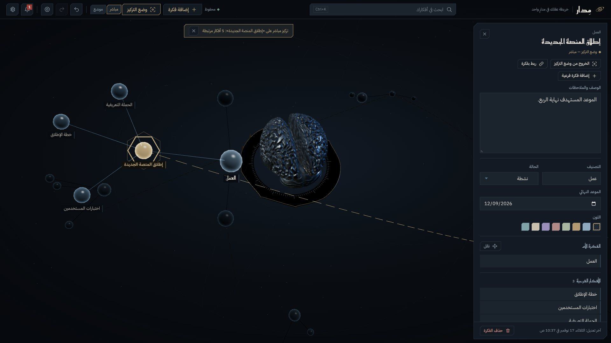

# ORBITAL MIND — مِدار

A local-first, desktop-first **3D second brain**. A large, glossy dark-glass
brain (with cerebellum and an organic brainstem) floats at the centre like a planet; your ideas orbit it in a spherical
"atmosphere" shell with a clear gap from its surface. Primary ideas are spread through the
shell, sub-ideas cluster around their parents, and any two ideas can be cross-connected. Notes, deadlines and reminders
live with each idea. Everything happens in one workspace.

**The user interface is entirely in Arabic and right-to-left.** Code, docs and
comments are in English.



## Features

* **3D orbital network** (React Three Fiber): rotate (drag), zoom (wheel), pan (right-drag),
  click to select, double-click to fly to an idea, **drag an idea to move its whole branch**.
  Every idea stays visible by default; congestion is handled with spatial layout,
  zoom, distance-aware labels and density-aware lines, never by hiding nodes.
* **Unlimited hierarchy + arbitrary cross-connections.** Hierarchy cycles are rejected;
  cross-link cycles are allowed. Moving an idea never breaks its connections.
* **Focus Mode** (`F`): direct (1 hop) or extended (2 hops, `Shift+F`) over both
  hierarchy and cross-links. The rest is dimmed, the camera frames the area, and `Esc`
  restores the previous view. Data is never changed.
* **Details panel** (right side): title, notes, category, status, colour, deadline,
  parent and move, sub-ideas, related ideas with relation labels, reminders, delete.
* **Reminders**: one-off or daily/weekly/monthly/yearly, timezone-aware (DST-safe),
  grouped as overdue / today / upcoming / completed in the notification centre, with
  native browser notifications when permitted.
* **Primary Ideas navigator** (top bar: *الأفكار الرئيسية*): lists only the top-level ideas, each
  expandable to reveal its branch. Clicking any entry selects it and flies the 3D camera to it;
  inside Focus Mode it re-frames the focus. A navigation aid alongside the scene, not a replacement.
* **Presentation view** (top bar: *وضع العرض*): a desktop-only immersive view. The toolbar, search,
  buttons, panels and banners disappear, and the brain, ideas, labels and links fill the window, still
  fully interactive (drag to rotate, scroll to zoom, click to select, arrow keys to explore). An overview
  is reframed for the whole window; a selection or Focus Mode view is kept. `Esc`, or the quiet exit
  button that appears when the mouse moves, returns to the workspace with its view, selection,
  search text and drafts intact. Local data only: no pairing, no network. Separate from TV mode and Focus Mode.
* **TV mode + iPhone companion** (top bar: *وضع التلفاز*): the TV renders the live 3D scene at its
  own resolution (16:9 composition, chrome hidden, double-tap/double-click empty space or the TV
  remote for the toolbar). Pair a phone with a QR code or a pairing code; after the TV owner approves,
  the phone orbits, zooms, selects, drives Focus Mode and the overview filter, and—with consent—shows
  its own ideas on the TV from a temporary in-memory copy. Peer-to-peer WebRTC; no backend to deploy.
  See [`docs/TV_MODE.md`](docs/TV_MODE.md).
* **Overview mode** (top bar: *إظهار الأفكار الرئيسية فقط*, shortcut `P`): renders only the
  top-level ideas, hiding branches and links. A pure view filter: no data changes, instantly
  reversible, not saved across reloads. Navigating to a hidden idea (search, panels) reveals the
  full network automatically; entering Focus Mode leaves the overview.
* **Arabic-aware search** (`Ctrl+K`): ignores tashkeel, unifies hamza/alef forms,
  taa marbuta and alef maqsura.
* **Safety**: auto-save to IndexedDB, undo/redo (`Ctrl+Z` / `Ctrl+Shift+Z`) for every
  edit, confirmation before deletes and imports, JSON export/import with validation,
  migrations, automatic local backups before an import, and a quarantine for corrupt records.
* **Accessibility**: full keyboard shortcuts (using physical key codes, so they work on an
  Arabic layout), visible focus rings, labelled icon buttons, reduced-motion support,
  and HTML equivalents (search and panel lists) for navigating the 3D graph.

## Quick start

```bash
npm install
npm run dev          # http://localhost:5173
```

Production build and preview:

```bash
npm run build        # type-check + Vite build → dist/
npm run preview      # http://localhost:4173
```

The app is a static bundle with no backend. Deploy `dist/` to any static host
(it must be served over HTTPS or localhost for notifications to work).

### Windows desktop (portable)

The same app as a portable Windows x64 program (Electron): `ORBITAL MIND.exe` plus `Data/`
(the database, kept next to the program) and `Backups/` (verified Daily, Weekly, Manual and
Safety JSON backups). Copy the folder to move it between computers. Build it with
`npm run dist:win`; the tested build is produced by the *Windows desktop (portable)* workflow.
See [`docs/DESKTOP.md`](docs/DESKTOP.md) and the Arabic guide [`docs/DESKTOP_GUIDE_AR.txt`](docs/DESKTOP_GUIDE_AR.txt).

## Tests

```bash
npm test             # Vitest unit tests (domain, application, storage, codec, perf timings)
npm run build && npm run test:e2e    # Playwright browser tests (uses the preview server)
npm run bench        # rendering benchmark at 100 / 500 / 1000 nodes
npm run dist:linux-dir && npm run test:desktop   # packaged desktop app tests (Linux: run under xvfb-run)
```

On a machine where Playwright's Chromium is not installed, run `npx playwright install chromium` first.

Current status: **74 unit tests, 29 browser tests and 9 packaged-desktop tests passing** (the TV pairing tests run over real WebRTC with a local PeerJS server, which Playwright starts automatically); production build succeeds.

## Keyboard shortcuts

| Key | Action |
|---|---|
| `Ctrl+K` | Search |
| `N` / `Shift+N` | New idea / new sub-idea of the selection |
| `F` / `Shift+F` | Toggle Focus Mode / switch direct ↔ extended |
| `P` | Show primary ideas only (overview) on/off |
| Presentation view | Esc: back to the workspace · arrows: explore · mouse: rotate / zoom / select |
| TV mode | OK/Enter/Menu or Back: toolbar · D-pad: orbit · +/−, Page/Channel: zoom |
| `L` | Link the selected idea (then click a target in 3D) |
| `← →` | Previous / next sibling |
| `↑ ↓` | Parent / first child |
| `Delete` | Delete selected (with confirmation) |
| `Ctrl+Z`, `Ctrl+Shift+Z` / `Ctrl+Y` | Undo / redo |
| `Esc` | Close the topmost panel, exit focus, clear selection |

## Stack

React 19 · TypeScript 5.9 · Vite 8 · Three.js 0.187 · @react-three/fiber 9 ·
@react-three/drei 10 · Zustand 5 (UI state only) · Dexie 4 (IndexedDB) · Zod 4 ·
Vitest 5 · Playwright 1.63. Fonts are self-hosted via Fontsource (IBM Plex Sans Arabic, Reem Kufi).

## Documentation

* [`docs/ARCHITECTURE.md`](docs/ARCHITECTURE.md): layers, data flow, graph rules,
  rendering design, migrations, data safety.
* [`docs/DESIGN_SYSTEM.md`](docs/DESIGN_SYSTEM.md): visual direction, tokens, components, accessibility.
* [`docs/PERFORMANCE.md`](docs/PERFORMANCE.md): measured benchmarks and the optimisations they led to.
* [`docs/TV_MODE.md`](docs/TV_MODE.md): TV presentation, phone controller, security, privacy, verification and limits.
* [`docs/DESKTOP.md`](docs/DESKTOP.md): Windows portable app — storage, backups, migration, updates, security, tests.
* [`.claude/skills/README.md`](.claude/skills/README.md): the agent skills used to build this, with licences.

## Known limitations

* **Reminders only fire while the app is open in a browser tab.** There is no push
  server or service-worker scheduling, so nothing is delivered while the browser or tab
  is closed. Reminders that fell due meanwhile are flagged as *missed* and announced at
  the next launch. Background tabs throttle timers; the scheduler re-checks at least
  every 30 s and on tab focus, so delivery can be late by up to about 30 s (longer if
  the browser freezes the tab entirely).
* Native notifications require permission and a secure context (HTTPS or localhost).
  Some platforms (e.g. Android Chrome) only allow notifications from a service worker;
  there the app falls back to in-app toasts.
* Data is stored **per browser profile and per device** (IndexedDB). There is no sync yet:
  use JSON export/import to move data. Clearing site data deletes it.
* If IndexedDB is unavailable (some private-browsing modes), the app runs in memory and
  warns you to export before closing.
* Performance was measured only on a CPU software renderer (no GPU was available); see
  `docs/PERFORMANCE.md`. Real-GPU numbers have not been measured. The larger glass brain made
  software-rendered frames ~20–30 ms slower than the previous version.
* Networks saved by earlier versions are moved outward once on load (radial shift), so no idea sits
  inside the enlarged brain. This migration is saved and is not an undo step.
* TV mode: verified on the live site with the public signaling server, but only between two browser
  profiles on one machine. Not yet tested on a real iPhone, Mi TV Stick or home network; devices on
  different networks may need a TURN relay (not configured). See `docs/TV_MODE.md`.
* `npm audit` reports 6 high-severity ReDoS advisories in **development-only** tooling (picomatch via
  Vite/Vitest); production dependencies report 0. The offered fix is a breaking Vitest downgrade.
* The interface is desktop-first (mouse + keyboard, ≥ 1280 px wide). Phone layouts are out of scope.
* Undo history is in-memory (last 100 steps) and resets on reload. Saved data does not.
* Native `<input type="date|datetime-local">` pickers render in the browser's own locale.
* The brain is procedural (no external 3D asset).

## Project layout

```
src/
  app/            composition root, providers
  domain/         entities, graph rules, layout, reminders (no React/Three)
  application/    commands, queries, services, ports
  infrastructure/ Dexie repository, JSON backup codec, browser notifications, WebRTC transport
  presentation/   3D scene, panels, UI, TV mode + controller, hooks, i18n (Arabic copy)
  design-system/  tokens, typography, components
  shared/         utilities
tests/
  unit/  e2e/  bench/
```
